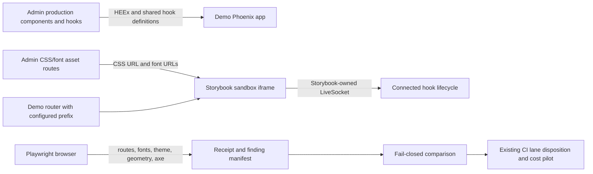

# Phase 174: Faithful Storybook and Quiet Quick Views - Research

**Researched:** 2026-10-26  
**Domain:** Phoenix LiveView component fidelity, Storybook routing, browser accessibility evidence  
**Confidence:** HIGH

## User Constraints

### Approved scope and fences

- `CONTEXT.md` does not exist; this research uses the approved roadmap, requirements, project decisions, and upstream scope already accepted for planning. No clarification is needed.
- Address only UXF-11, STORY-03 through STORY-06, and UIQ-05. The roadmap also carries the STORY-07 and UIQ-07 obligations forward. [VERIFIED: `.planning/ROADMAP.md:63-73`; exact values: `**Requirements:** UXF-11, STORY-03, STORY-04, STORY-05, STORY-06, UIQ-05` and `continuing STORY-07 obligation`, `continuing UIQ-07 obligation`]
- Keep scope to the repaired quick views, faithful navigation/theme/font/hook behavior, retained scenarios, and the evidence needed to prove them. The approved fence says: “No complete catalogue, generic fixture engine, client upgrade or new dependency is a prerequisite.” [VERIFIED: `.planning/ROADMAP.md:73`; exact quote]
- Preserve the zero-Node adopter contract: Node remains dev/CI tooling only; do not add a shipped Node dependency or asset pipeline. If production CSS source changes, rebuild and commit its generated bundle as required by the project guide. [VERIFIED: `CLAUDE.md:10,129`; exact quotes: `Three sibling Hex packages, MIT, no Node toolchain anywhere:` and `Don't write to mailglass_admin/priv/static/ without committing the rebuilt bundle (CI runs git diff --exit-code).`; `.planning/PROJECT.md:522-523` says “Zero-Node stays adopter-facing” and names opt-in `mix ci.browser`]
- Reuse current production CSS, components, hooks, ExUnit, Playwright, and axe. Start with small scenario metadata and prove the repaired quick-view area before expanding extraction. [VERIFIED: `.planning/research/ui-quality-engine/UPSTREAM-SCOPE.md:82-94`; exact quote: “Share hook implementation while Storybook owns its socket.”]
- The cold/warm cost targets remain provisional, not a measured promise: “≤5 minutes added PR wall time and ≤10 added runner-minutes,” including setup. The pilot must measure actual CI cost before proposing a permanent gate. [VERIFIED: `.planning/research/ui-quality-engine/RECOMMENDATIONS.md:105`; exact quote]
- Do not weaken existing CI gates or turn unrelated accessibility debt into a phase prerequisite. Keep incomplete axe findings separately triaged from missing or failed execution. [VERIFIED: `.planning/REQUIREMENTS.md:82-97`; exact quote: “Distinguish axe violations, separately triaged incomplete findings, and missing/incomplete execution; no vacuous pass or quiet rebaseline.”]

## Summary

The current Admin quick views already expose named previous/next controls, position, and Close. Their active arrow and Close classes include `min-h-11 min-w-11`; both arrow controls also have visible borders. The plan should remove visual emphasis from the arrows while retaining their hit areas, names, focus treatment, and boundary semantics, then add browser-measured target checks. The two surfaces differ at a disabled boundary: Operator renders a labeled `aria-disabled` span and Inbound a disabled button. Keep those semantics intact unless the task proves a change is needed. [VERIFIED: `mailglass_admin/lib/mailglass_admin/operator/quick_view.ex:65-91,188-211`; exact values: `aria-live="polite"`, `{@position.index} of {@position.total}`, `aria-label="Close quick view"`, `min-h-11 min-w-11`, `border border-base-300`, `aria-disabled="true"`. `mailglass_admin/lib/mailglass_admin/inbound/quick_view.ex:59-85,176-201`; exact values: `disabled`, `aria-label={@label}`, `min-h-11 min-w-11`, `border border-base-300`]

The clearest Storybook defect is its route macro. The demo router invokes `live_storybook("/storybook", ...)` inside a path scope `"/dev"`; the pinned PhoenixStorybook 1.2.0 documentation explicitly disallows calling that macro in a scope whose path differs from `/`. Mount it from a root scope with the full configured path, align the Storybook asset path, and verify root/sidebar/theme-picker/deep-link URLs in the browser. [VERIFIED: `reference/demo_app/lib/mailglass_demo_web/router.ex:18-27`; exact quote: `scope "/dev" do` / `live_storybook("/storybook", backend_module: MailglassDemoWeb.Storybook)`. CITED: [PhoenixStorybook 1.2.0 router source](https://github.com/phenixdigital/phoenix_storybook/blob/v1.2.0/lib/phoenix_storybook/router.ex), lines 746-748]

Use the existing PhoenixStorybook mount and production Admin quick-view components; retain one normal and one boundary scenario for each surface. Current evidence already hashes production CSS and compares the served bundle with the committed Admin bundle, but it does not report successful font loads, loaded weights, computed typography roles, or the theme owner. Current axe evidence counts rule IDs and failing nodes, not stable rule/target/state fingerprints, and it does not prove a complete expected execution set. Build those receipts and comparisons as small, scenario-specific evidence. [VERIFIED: `reference/demo_app/assets/e2e/persona-screenshots.spec.js:237-315`; `mailglass_admin/e2e/axe-baseline.spec.js:203-227,267-319`; `mailglass_admin/test/mailglass_admin/axe_baseline_test.exs:51-97,265-328`]

**Primary recommendation:** Fix the Storybook route at the pinned PhoenixStorybook 1.2.0 API seam; make small visual and evidence changes around the current production components; register shared production hooks through Storybook’s own hook extension point without loading the Admin socket bootstrap into Storybook; and keep connected browser proof separate from static rendering proof.

## Phase Requirements

| ID | Description | Research Support |
|----|-------------|------------------|
| UXF-11 | An operator can use quieter previous/next controls on both quick views with readable position, coherent Close, 44px targets, accessible names, focus and disabled boundaries. | Existing production components already contain position, labels, focus-ring classes, and 44px minimum-size utility classes. Add browser geometry assertions and verify disabled boundary behavior on both real routes. [VERIFIED: `mailglass_admin/lib/mailglass_admin/operator/quick_view.ex:65-91,188-211`; `mailglass_admin/lib/mailglass_admin/inbound/quick_view.ex:59-85,176-201`] |
| STORY-03 | A maintainer can open Storybook and navigate its root, sidebar and deep links under the configured mount prefix without broken destinations. | Pinned PhoenixStorybook docs forbid the current non-root scope macro placement; test all named route surfaces against the configured prefix. [VERIFIED: `reference/demo_app/lib/mailglass_demo_web/router.ex:18-27`][CITED: [PhoenixStorybook 1.2.0 router source](https://github.com/phenixdigital/phoenix_storybook/blob/v1.2.0/lib/phoenix_storybook/router.ex)] |
| STORY-04 | A maintainer can review repaired areas using production CSS and actual loaded production font faces/weights with matching UI, display and code roles. | Existing CSS/hash receipt can be extended with font response status, loaded face/weight, and computed style evidence. [VERIFIED: `reference/demo_app/assets/e2e/persona-screenshots.spec.js:237-315`; `mailglass_admin/assets/css/app.css:146-195,475-484`] |
| STORY-05 | A maintainer can review repaired areas in Light, Dark and System with explicit theme ownership and correct response to OS preference changes in System mode. | Existing primitive stories set fixed `data-theme` per variation. Add a focused quick-view proof where System follows both emulated OS schemes and document whether the sandbox or story template owns resolution. [VERIFIED: `reference/demo_app/dev/mailglass_demo_web/storybook.ex:19-26`; `reference/demo_app/storybook/primitives/theme_picker.story.exs`] |
| STORY-06 | A maintainer can exercise hook-dependent retained scenarios through shared production hook behavior while Storybook owns its own socket lifecycle. | Admin production hooks are inline in its asset bootstrap, which also creates and connects an Admin LiveSocket. PhoenixStorybook exposes `js_path` for hook registration before its own client. Extract/share the hook definitions without bringing the Admin socket bootstrap into Storybook; prove lifecycle behavior against both locked clients. [VERIFIED: `mailglass_admin/lib/mailglass_admin/controllers/assets.ex:64-100,180-192`; `reference/demo_app/dev/mailglass_demo_web/storybook.ex:25-40`][CITED: [PhoenixStorybook setup guide](https://github.com/phenixdigital/phoenix_storybook/blob/v1.2.0/guides/setup.md), [Phoenix LiveView JS interop 1.1.33](https://phoenix-live-view.hexdocs.pm/1.1.33/js-interop.html), [Phoenix LiveView JS interop 1.2.13](https://phoenix-live-view.hexdocs.pm/1.2.13/js-interop.html)] |
| UIQ-05 | A maintainer running the selected accessibility sweep gets fresh rule/target/state comparisons against approved findings and a failing result for missing, failed or incomplete expected execution. | Current producer checks required overlays but persists only rule counts; current ExUnit comparator checks per-rule counts/cells. Add a small expected/executed manifest and stable finding fingerprints; fail closed on missing cells, failed scans, zero scans, incomplete expected execution, and untriaged incomplete findings. [VERIFIED: `mailglass_admin/e2e/axe-baseline.spec.js:181-227,267-319`; `mailglass_admin/test/mailglass_admin/axe_baseline_test.exs:51-97,265-328`][CITED: [axe-core 4.11.1 API](https://github.com/dequelabs/axe-core/blob/v4.11.1/doc/API.md)] |

## Architectural Responsibility Map

| Capability | Primary Tier | Secondary Tier | Rationale |
|------------|-------------|----------------|-----------|
| Quick-view appearance, 44px geometry, focus and disabled controls | Browser / Client | Admin component layer | Production HEEx supplies markup and utility classes; rendered browser geometry, hover, focus, and connected navigation prove the actual behavior. [VERIFIED: `mailglass_admin/lib/mailglass_admin/operator/quick_view.ex:65-91,188-211`; `mailglass_admin/e2e/flows.spec.js:1409-1459`] |
| Storybook mount, sidebar, and deep-link URL preservation | Frontend Server (Demo router) | Browser / Client | PhoenixStorybook route macros generate the routes; Playwright follows generated navigation and verifies the prefix. [VERIFIED: `reference/demo_app/lib/mailglass_demo_web/router.ex:1-27,72-103`] |
| Production CSS/font/theme fidelity | Browser / Client | Admin asset endpoint | The demo Storybook iframe loads the Admin CSS route, and font URLs resolve through the Admin asset controller. Browser responses and computed styles are the receipt. [VERIFIED: `reference/demo_app/dev/mailglass_demo_web/storybook.ex:34-41`; `mailglass_admin/lib/mailglass_admin/controllers/assets.ex:48-52,488-501`; `mailglass_admin/assets/css/app.css:146-195,475-484`] |
| Hook sharing and lifecycle | Browser / Client | Admin asset module and Demo Storybook backend | LiveView hooks require a connected client for update/destroy behavior. Storybook must register hook definitions with the Storybook-owned LiveSocket; Admin has its own existing LiveSocket. [VERIFIED: `mailglass_admin/lib/mailglass_admin/controllers/assets.ex:75-100,180-192`][CITED: [Phoenix LiveView JS interop 1.1.33](https://phoenix-live-view.hexdocs.pm/1.1.33/js-interop.html)] |
| Fresh accessibility findings and CI disposition | Browser / Client | Test/CI | axe analyzes a rendered state; ExUnit or a small manifest checker compares evidence; CI job policy determines whether a failing run is required. [VERIFIED: `mailglass_admin/e2e/axe-baseline.spec.js:222-263`; `.github/workflows/ci.yml:954-1068,1426-1451`] |

## Standard Stack

Use the already pinned stack. Do not add or upgrade packages for this phase.

| Component | Locked version / current value | Purpose | Evidence |
|-----------|-------------------------------|---------|----------|
| PhoenixStorybook | `1.2.0` | Demo-only Storybook router, sandbox, stories, and browser assets. | `"phoenix_storybook": {:hex, :phoenix_storybook, "1.2.0"...}` [VERIFIED: `reference/demo_app/mix.lock:41`] |
| Phoenix LiveView, Demo | `1.1.33` | Storybook host LiveView/client compatibility target. | `"phoenix_live_view": {:hex, :phoenix_live_view, "1.1.33"...}` [VERIFIED: `reference/demo_app/mix.lock:39`] |
| Phoenix LiveView, Admin | `1.2.13` | Production quick-view and hook compatibility target. | `"phoenix_live_view": {:hex, :phoenix_live_view, "1.2.13"...}` [VERIFIED: `mailglass_admin/mix.lock:38`] |
| Playwright, Admin | `@playwright/test` `1.59.1` | Existing operator interaction and axe test runner. | `"version": "1.59.1"` [VERIFIED: `mailglass_admin/package-lock.json:26-30`] |
| Playwright, Demo | `@playwright/test` `1.60.0` | Existing Storybook/demo browser evidence runner. | `"version": "1.60.0"` [VERIFIED: `reference/demo_app/assets/package-lock.json:12-20`] |
| axe Playwright adapter | `@axe-core/playwright` `4.11.3`; depends on `axe-core ~4.11.4` | Existing accessibility scans in Admin browser tests. | `"version": "4.11.3"` / `"axe-core": "~4.11.4"` [VERIFIED: `mailglass_admin/package-lock.json:13-21`] |
| Project runtime | `.tool-versions` declares Erlang/OTP `27.3.4.13`, Elixir `1.18.4`; CI browser jobs use Node `22`. | Keep project runtime and CI versions fixed. | `erlang 27.3.4.13` / `elixir 1.18.4` [VERIFIED: `.tool-versions:1-2`]; CI sets `node: "22"` [VERIFIED: `.github/workflows/ci.yml:954-997`] |

Admin and Demo intentionally resolve different LiveView versions. Verify the shared hook against both existing lockfiles; do not upgrade either client as a shortcut. [VERIFIED: `reference/demo_app/mix.lock:39-41`; `mailglass_admin/mix.lock:38`]

**Installation:** None. No new package installation is a prerequisite. Package legitimacy audit is not applicable because this phase’s approved scope excludes dependency additions/upgrades. [VERIFIED: `.planning/ROADMAP.md:73`; exact quote: “client upgrade or new dependency is not a prerequisite.”]

## Architecture Patterns

### System Architecture Diagram



### Recommended Project Structure

Keep new story and browser-evidence code in the existing Demo and Admin test seams. Do not move Storybook modules into the published Admin library.

```text
reference/demo_app/lib/mailglass_demo_web/router.ex       # top-level prefixed mount
reference/demo_app/dev/mailglass_demo_web/storybook.ex    # existing PhoenixStorybook backend and asset URLs
reference/demo_app/storybook/                             # retained quick-view stories/scenario metadata
reference/demo_app/assets/e2e/                            # demo-side Storybook URL and fidelity evidence
mailglass_admin/lib/mailglass_admin/operator/quick_view.ex # production Deliveries component
mailglass_admin/lib/mailglass_admin/inbound/quick_view.ex  # production Inbound component
mailglass_admin/lib/mailglass_admin/controllers/assets.ex # production asset and LiveSocket boundary
mailglass_admin/e2e/                                      # connected operator behavior and axe comparison
```

These paths are current repository locations, not new-file mandates. [VERIFIED: the cited source files were opened in this session; `storybook.ex:34-40` sets `content_path: Path.expand("../../storybook", __DIR__)` and references the Demo stories path.]

### Pattern 1: Mount the pinned Storybook router at the application root scope

**What:** Put the route macro inside a root (`"/"`) router scope and pass the complete Storybook path, including `/dev`; set the Storybook asset route to the matching prefix. Use its generated helper for navigable links and test generated links as well as direct route entry. **When:** Any Storybook deployment mounted under a prefix.

The current macro expands under `scope "/dev"` and supplies `"/storybook"`. PhoenixStorybook 1.2.0 says its macro cannot be used in a non-root path scope; its docs show `storybook_assets()` and `live_storybook` from root scopes, with `assets_path` matched to the mount. [VERIFIED: `reference/demo_app/lib/mailglass_demo_web/router.ex:18-27`; exact quote: `scope "/dev"` and `live_storybook("/storybook", backend_module: MailglassDemoWeb.Storybook)`.][CITED: [PhoenixStorybook 1.2.0 router source](https://github.com/phenixdigital/phoenix_storybook/blob/v1.2.0/lib/phoenix_storybook/router.ex), [PhoenixStorybook setup guide](https://github.com/phenixdigital/phoenix_storybook/blob/v1.2.0/guides/setup.md)]

### Pattern 2: Story the production component, not a copied preview

**What:** Add the first normal and boundary story for each production quick-view component, using the component function and only the minimum plain-data inputs/metadata it requires. Retain existing primitive stories. Keep static rendering checks for appearance and connected routes for focus/navigation and hooks. **When:** A component has meaningful state or browser-only lifecycle behavior.

Current `storybook.ex` points to `../../storybook`; existing primitive stories are `*.story.exs`, and source comments state that stories belong in the Demo app because PhoenixStorybook is dev-only. [VERIFIED: `reference/demo_app/dev/mailglass_demo_web/storybook.ex:28-40`; exact values: `"../../storybook"`, `"mg-admin-root"`, and `css_path: "/dev/mail/css-" <> MailglassAdmin.Controllers.Assets.css_hash()`]

### Pattern 3: Share hook definitions while keeping one socket per app

**What:** Make the production hook implementation consumable by both Admin’s current bootstrap and PhoenixStorybook’s `js_path` hook registration. Do not load the entire Admin bundle into the Storybook iframe: Admin’s bundle creates and connects a `LiveSocket`, while PhoenixStorybook owns its client. Connected browser proof must show mount, update, teardown/close, and focus restoration where supported, for Demo LiveView 1.1.33 and Admin LiveView 1.2.13. **When:** A retained scenario uses `phx-hook` or depends on LiveView patches.

`ModalFocusTrap` currently has `mounted` and `destroyed` callbacks in the Admin asset string, followed by the Admin `LiveSocket` creation and `connect()`. [VERIFIED: `mailglass_admin/lib/mailglass_admin/controllers/assets.ex:75-100,180-192`; exact values: `ModalFocusTrap`, `mounted()`, `destroyed()`, `new LiveView.LiveSocket("/live", Phoenix.Socket, {`, `hooks: Hooks`, `liveSocket.connect()`]. The pinned PhoenixStorybook setup guide documents `js_path` as the app-served asset loaded before PhoenixStorybook JS for `window.storybook.Hooks`. [CITED: [PhoenixStorybook setup guide](https://github.com/phenixdigital/phoenix_storybook/blob/v1.2.0/guides/setup.md)]

### Pattern 4: Evidence receipt identifies bytes, loaded fonts, theme owner, and scenario

**What:** For each selected scenario, record source revision, actual browser URL, source/built/served CSS SHA-256, served route digest, font response URLs/statuses, matching `FontFace` family/weight/status, computed UI/display/code font-family roles, selected theme, OS preference, hook/socket proof, and the scenario ID. Compare font roles only after `document.fonts.ready`; also inspect actual matching loaded faces and successful responses. The CSS Font Loading spec says `ready` resolves after font and layout work settles. Do not make `document.fonts.check()` alone the proof of a required face. **When:** Testing asset or theme fidelity.

Current CSS source declares the families and weights below, and the existing readiness test already logs source/built/served CSS digests. [VERIFIED: `mailglass_admin/assets/css/app.css:152-186,192-195,475-484`; exact values: `font-family: 'Inter'`, `font-weight: 400`, `font-weight: 700`, `font-family: 'Inter Tight'`, `font-family: 'IBM Plex Mono'`, `--font-ui`, `--font-display`, `--font-mono`. `reference/demo_app/assets/e2e/persona-screenshots.spec.js:255-264,298-313`]

The browser font API loads faces when used; `document.fonts.ready` resolves when loading/layout has settled. [CITED: [W3C CSS Font Loading Module Level 3](https://www.w3.org/TR/css-font-loading/)] The current source allows only the six Inter/Inter Tight/IBM Plex Mono WOFF2 files at 400 and 700. [VERIFIED: `mailglass_admin/lib/mailglass_admin/controllers/assets.ex:488-501`; exact quote: `inter-400.woff2 inter-700.woff2`, `inter-tight-400.woff2 inter-tight-700.woff2`, `ibm-plex-mono-400.woff2 ibm-plex-mono-700.woff2`]

### Pattern 5: Compare axe findings at rule + target + scenario/state granularity

**What:** Define a small expected scenario manifest and a completed-execution manifest. Each axe finding fingerprint should include rule ID, stable target selector, and explicit scenario/state (including theme and boundary position); keep evidence version and URL. Fail closed if expected scenarios are missing, scans fail, zero scenarios execute, executions are duplicated or incomplete, or expected cells are empty. Store `incomplete` findings in their own review list with a disposition instead of treating them as violations or as a pass. Avoid persisting raw HTML snippets in the comparison artifact.

axe results distinguish `violations`, `incomplete`, `inapplicable`, and `passes`; returned nodes include `target`. [CITED: [axe-core 4.11.1 API](https://github.com/dequelabs/axe-core/blob/v4.11.1/doc/API.md)] Current producer already throws when required overlays fail to open and asserts all nine existing surface/theme cells before a baseline promotion, but stores only total and counts by rule ID. Keep that useful fail-closed behavior and add target/state-level evidence for the selected phase scenarios. [VERIFIED: `mailglass_admin/e2e/axe-baseline.spec.js:181-227,267-319`; exact values: `SURFACES = ["deliveries", "inbound", "preview"]`, `THEMES = ["light", "dark", "system"]`, `measured`, `missing measured cell`, persisted `{ total, rules }`]

## Don't Hand-Roll

| Problem | Don't Build | Use Instead | Why |
|---------|-------------|-------------|-----|
| Storybook URL prefixing | A client-side link-rewrite layer or regex-only route workaround | PhoenixStorybook 1.2.0 router macro at root scope, full mount path, matching `assets_path` | The pinned macro already defines its route and internal links; current path scope contradicts its documented constraint. [CITED: [router source](https://github.com/phenixdigital/phoenix_storybook/blob/v1.2.0/lib/phoenix_storybook/router.ex)] |
| Story preview markup | Duplicate “storybook-only” quick-view HTML | Existing Admin production component functions and minimal scenario inputs | Duplicated markup can drift from the real route presentation. [VERIFIED: `mailglass_admin/lib/mailglass_admin/operator/quick_view.ex`; `mailglass_admin/lib/mailglass_admin/inbound/quick_view.ex`] |
| Hook/socket runtime | Another LiveSocket bootstrap in the Storybook iframe | PhoenixStorybook’s own LiveSocket plus shared production hook definitions through `js_path` | Full Admin JS already creates its own socket. [VERIFIED: `mailglass_admin/lib/mailglass_admin/controllers/assets.ex:180-192`][CITED: [PhoenixStorybook setup guide](https://github.com/phenixdigital/phoenix_storybook/blob/v1.2.0/guides/setup.md)] |
| Accessibility engine | Custom DOM rule scanner or another axe wrapper | Existing `@axe-core/playwright`, current axe-core, and small repository-owned comparison glue | Existing Admin dependencies already provide scans; phase needs comparison rigor and completeness accounting, not another scanner. [VERIFIED: `mailglass_admin/package-lock.json:13-21`] |
| Fixture/scenario framework | Generic preview engine, profile catalog or broad database fixture framework | Small scenario metadata for the first quick-view cases | Explicit phase scope requires proving one repaired area before broader extraction. [VERIFIED: `.planning/ROADMAP.md:73`; exact quote: “prove one repaired area before expanding extraction.”] |

## Common Pitfalls

1. **Prefix stripping inside nested scope.** `live_storybook` invoked under a path-bearing scope violates the pinned library contract; direct links might appear to work while root/sidebar paths lose the prefix. Mount from root scope and exercise every required navigation path. [VERIFIED: `reference/demo_app/lib/mailglass_demo_web/router.ex:18-27`][CITED: [PhoenixStorybook 1.2.0 router source](https://github.com/phenixdigital/phoenix_storybook/blob/v1.2.0/lib/phoenix_storybook/router.ex)]
2. **Utility class mistaken for measured size.** `min-h-11 min-w-11` is present, but acceptance is a 44px rendered target. Measure the actual bounding box at the supported narrow layout, including disabled-boundary states. [VERIFIED: `mailglass_admin/lib/mailglass_admin/operator/quick_view.ex:203-209`; `mailglass_admin/lib/mailglass_admin/inbound/quick_view.ex:193-199`]
3. **Quiet styling erases state cues.** Removing the border from arrows must preserve accessible names, visible hover/focus, current/disabled distinction, and 44px hit area. Preserve position and Close hierarchy in the same header; it is a shared four-item control row. [VERIFIED: `mailglass_admin/lib/mailglass_admin/operator/quick_view.ex:69-91`; `mailglass_admin/lib/mailglass_admin/inbound/quick_view.ex:63-85`]
4. **Storybook own socket accidentally doubled.** `js_path` is for custom hooks before Storybook JS. Loading the full Admin JS asset in the iframe adds the Admin LiveSocket bootstrap; register hook definitions only. [VERIFIED: `mailglass_admin/lib/mailglass_admin/controllers/assets.ex:180-192`][CITED: [PhoenixStorybook setup guide](https://github.com/phenixdigital/phoenix_storybook/blob/v1.2.0/guides/setup.md)]
5. **Static story mistaken for connected behavior.** A static component story can prove rendered presentation but cannot prove LiveView update/destroy lifecycle, URL history, or focus return. Add connected proof through the actual Storybook socket and keep Admin and Demo clients separately represented. [CITED: [Phoenix LiveView JS interop 1.1.33](https://phoenix-live-view.hexdocs.pm/1.1.33/js-interop.html), [Phoenix LiveView JS interop 1.2.13](https://phoenix-live-view.hexdocs.pm/1.2.13/js-interop.html)]
6. **Font receipt says “ready” without proving brand faces.** Wait for `document.fonts.ready`, record successful font responses and the matched loaded `FontFace` family/weight, and inspect computed styles on body, headings, and code. [VERIFIED: `mailglass_admin/assets/css/app.css:152-186,475-484`][CITED: [W3C CSS Font Loading Module Level 3](https://www.w3.org/TR/css-font-loading/)]
7. **Old axe count produces a vacuous green.** Existing totals/per-rule counts do not identify targets or scenario state. Require a nonempty expected list, an execution record for every expected case, and fail on missing, failed, zero, or untriaged incomplete work. Keep incomplete review findings separately visible. [VERIFIED: `mailglass_admin/e2e/axe-baseline.spec.js:203-227,267-319`; `mailglass_admin/test/mailglass_admin/axe_baseline_test.exs:51-97,265-328`][CITED: [axe-core 4.11.1 API](https://github.com/dequelabs/axe-core/blob/v4.11.1/doc/API.md)]
8. **Gate label overstates merge protection.** A failing workflow job does not become a required PR check unless the protected aggregate depends on it. Read current main protection, report job status honestly, and only promote after the measured cost pilot. [VERIFIED: live GitHub branch-protection API checked 2026-10-26: `contexts: ["CI Green", "Guard Release Trigger"]`; `.github/workflows/ci.yml:1426-1451`; `mix.exs:466-473`]

## Code Examples

### Production quick-view controls (existing source pattern)

```heex
<span aria-live="polite" class="px-xs text-label tabular-nums text-secondary">
  {@position.index} of {@position.total}
</span>
<.link aria-label="Close quick view" class="mg-focus-ring btn btn-ghost min-h-11 min-w-11 ml-xs">
```

These exact strings exist in the Admin source; the Storybook proof should use the production component and assert rendered dimensions and focus/name state, not copy this markup. [VERIFIED: `mailglass_admin/lib/mailglass_admin/operator/quick_view.ex:73-91`; exact values shown above]

### Production typography roles (existing source pattern)

```css
body { font-family: 'Inter', system-ui, -apple-system, sans-serif; }
h1, h2, h3 { font-family: 'Inter Tight', 'Inter', system-ui, -apple-system, sans-serif; }
code, pre, .mono { font-family: 'IBM Plex Mono', ui-monospace, monospace; }
```

Use these source roles as the receipt’s expected family values, then compare the browser’s computed style and loaded-face evidence. [VERIFIED: `mailglass_admin/assets/css/app.css:475-484`; exact values shown above]

### Existing browser evidence command entry points

```bash
# Admin Playwright + axe suite
cd mailglass_admin && npm run test:operator-browser

# Demo Storybook/browser evidence in an isolated Docker Compose project
bash scripts/run_demo_browser_evidence.sh
```

The Admin script builds Admin assets and invokes Playwright with one worker; the Demo wrapper creates isolated ports, starts Demo/Postgres through Compose, runs Playwright, and verifies emitted evidence. [VERIFIED: `mailglass_admin/package.json:4-10`; `scripts/run_demo_browser_evidence.sh:1-3,16-19,55-88`]

## State of the Art

| Old approach | Current phase approach | Evidence / impact |
|--------------|-----------------------|-------------------|
| Use a nested `/dev` router scope and assume the library prefixes internal links | Follow pinned PhoenixStorybook 1.2.0’s root-scope route API; configure the full path and matching asset path | The tagged router source says the macro cannot be called in non-root scopes. [CITED: [PhoenixStorybook 1.2.0 router source](https://github.com/phenixdigital/phoenix_storybook/blob/v1.2.0/lib/phoenix_storybook/router.ex)] |
| Treat counts by axe rule as a sufficient UI regression baseline | Compare fresh rule/target/state findings, plus explicit expected/executed cases and separate incomplete triage | Current producer persists only `{ total, rules }`; axe provides target nodes and a distinct `incomplete` result array. [VERIFIED: `mailglass_admin/e2e/axe-baseline.spec.js:301-319`][CITED: [axe-core 4.11.1 API](https://github.com/dequelabs/axe-core/blob/v4.11.1/doc/API.md)] |
| Treat static story rendering as proof of all behavior | Use static production-component stories for rendering and connected real-client tests for hook lifecycle, navigation, and focus return | LiveView JS hook lifecycle callbacks depend on LiveView client behavior. [CITED: [Phoenix LiveView JS interop 1.1.33](https://phoenix-live-view.hexdocs.pm/1.1.33/js-interop.html), [1.2.13](https://phoenix-live-view.hexdocs.pm/1.2.13/js-interop.html)] |

## Assumptions Log

| # | Claim | Section | Risk if Wrong |
|---|-------|---------|---------------|
| A1 | The preferred router repair is to mount at an explicit full `/dev/storybook` path from a root scope, with Storybook assets configured at the matching prefixed path. | Architecture Patterns | If PhoenixStorybook 1.2.0 asset macro constraints differ from route macro constraints, implementation could still lose the prefix; verify both macros in the pinned tagged source while planning. |
| A2 | The phase can reuse Admin’s existing Playwright/axe installation to scan the Demo-hosted Storybook without adding a Demo dependency. | Validation Architecture | Runner/process topology may make the scan awkward; choose an existing dependency seam or document a scope exception rather than silently adding a package. |
| A3 | The six current brand font files and 400/700 weights are the required receipt set for repaired UI/display/code roles. | Pattern 4 | A production style may use a different face or weight; a real computed-style and network receipt will surface this before acceptance. |
| A4 | Current branch-protection contexts reflect the main-branch configuration relevant to Phase 174’s CI placement. | Common Pitfalls | Protection may change before the phase lands; re-check when deciding required status-check placement. |

## Open Questions

1. **RESOLVED (design): Demo-hosted axe runner.** [174-05-PLAN.md](174-05-PLAN.md) task 1 selects a dedicated Admin Playwright config/script using Admin’s existing locked `@axe-core/playwright`, targeting the run-owned Demo service. [174-06-PLAN.md](174-06-PLAN.md) task 1 provisions Admin’s version-owned Chromium before the scan. Remaining evidence: execute the 18-case real sweep and retain fresh report/identity; no new Demo dependency.
2. **RESOLVED (design): System owner.** [174-04-PLAN.md](174-04-PLAN.md) task 1 assigns each isolated quick-view story root ownership through the Demo-only matchMedia/radio adapter, with explicit data-theme-preference and resolved production data-theme. Remaining evidence: both initial OS preferences, live OS flips in System and explicit Light/Dark stability; existing static primitive variations are not that proof.
3. **RESOLVED (design): hook/socket proof.** [174-03-PLAN.md](174-03-PLAN.md) selects shared production hook bytes registered through window.storybook.Hooks and tests mount/patch/removal in Storybook plus actual open/update/close/focus return on Demo 1.1.33 and Admin 1.2.13. Uniqueness is per browsing document, permitting the explorer and intentionally isolated iframe each a legitimate owner while forbidding an extra Admin bootstrap. Remaining evidence: connected lifecycle/listener/socket observations on both locked clients.
4. **RESOLVED (design): advisory CI lane and initial pilot.** [174-06-PLAN.md](174-06-PLAN.md) keeps the existing demo_browser_evidence job advisory and invokes the wrapper with --phase174 --pilot in that job. Existing workflow_dispatch/PR execution supplies an identified source/run/job and hosted runner; protected CI Green policy is unchanged. Remaining evidence: actual cold/warm setup-inclusive wall/runner costs, live context snapshot and retained CI job receipts. No required promotion is presumed.

## Environment Availability

| Dependency | Required by | Available here | Version / evidence | Fallback |
|------------|-------------|----------------|--------------------|----------|
| Node.js | Existing Playwright/axe scripts | Yes | `v26.10.0`; CI pins Node 22. | Use the repo-pinned CI runtime for comparable cost/results. |
| npm | Lockfile-backed browser dependencies | Yes | `11.19.1` | `npm ci` from the relevant existing lockfile. |
| Elixir / Mix | Phoenix services and ExUnit | Not confirmed | `mix --version` and `elixir --version` fail through installed asdf shims with “No version is set”; `.tool-versions` declares Erlang `27.3.4.13`, Elixir `1.18.4`. | Use the project CI/runtime setup; do not claim local test availability until the shims resolve. |
| Docker CLI / Compose | Isolated Demo browser evidence | CLI available; daemon unverified | Docker `29.5.2`; Compose `5.1.3`. | If daemon is unavailable, use the existing Demo service environment or CI; do not run the Compose evidence wrapper without confirming Docker availability. |
| Chromium / Playwright browser binary | Browser validation | Not probed | Existing Playwright dependencies are in lockfiles; local browser installation was not checked. | Existing CI installs Chromium with Playwright. |
| GitHub branch protection | Decide required/advisory CI placement | Available through authenticated read-only API | On 2026-10-26 `main` required contexts were `CI Green` and `Guard Release Trigger`. [VERIFIED: `https://api.github.com/repos/szTheory/mailglass/branches/main/protection`] | Re-check when finalizing the plan because branch protection can change. |

## Validation Architecture

Nyquist validation is enabled: `.planning/config.json` contains `"nyquist_validation": true`. [VERIFIED: `.planning/config.json:22`; exact quote]

### Test Framework

| Property | Value |
|----------|-------|
| Framework | ExUnit in Admin plus Playwright Test in Admin and Demo; axe Playwright adapter is already locked in Admin. [VERIFIED: `mailglass_admin/package.json:4-10`; `reference/demo_app/assets/package.json:4-10`] |
| Config files | `mailglass_admin/playwright.config.cjs`; `reference/demo_app/assets/playwright.config.cjs`; `mailglass_admin/test/mailglass_admin/axe_baseline_test.exs` |
| Quick run command | `cd mailglass_admin && npm run test:operator-browser` (starts the Admin browser server and runs one-worker Playwright). |
| Demo evidence command | `bash scripts/run_demo_browser_evidence.sh` (run-owned Docker Compose + Demo Postgres + Playwright evidence). |
| Focused ExUnit command | `cd mailglass_admin && mix test test/mailglass_admin/axe_baseline_test.exs` (requires working Mix toolchain). |

### Phase Requirements → Test Map

| Req ID | Behavior | Test type | Existing command / planned assertion | Existing coverage |
|--------|----------|-----------|--------------------------------------|-------------------|
| UXF-11 | Quiet arrow appearance; position/Close; names, focus, disabled boundary; target size | Admin connected Playwright + DOM geometry | `cd mailglass_admin && npm run test:operator-browser`; add rendered bounding-box checks for active/disabled prev/next and Close on Deliveries and Inbound, focus/hover/name and boundary behavior. | Operator keyboard/focus restoration exists in `mailglass_admin/e2e/flows.spec.js:1409-1459`; responsive list/quick-view smoke exists in `mailglass_admin/e2e/structural.spec.js:1143-1259`. No explicit quick-view target-size geometry assertion is present in those reviewed cases. |
| STORY-03 | Storybook root, sidebar, theme-picker, deep link retain mount prefix | Demo Playwright | `bash scripts/run_demo_browser_evidence.sh`; assert root/sidebar/theme-picker/direct story destinations preserve the configured prefix and return successfully. | `persona-screenshots.spec.js:191-234,276-288` opens direct primitive URLs; no complete generated-navigation prefix walk. |
| STORY-04 | Production CSS bytes and fonts/roles | Demo Playwright receipt | Same Demo command; assert source/built/served digest parity, font response success, required loaded family/weight, and computed body/heading/code roles. | `persona-screenshots.spec.js:237-315` already compares built/served digest and logs source digest; no font-face or computed-role proof. |
| STORY-05 | Light/Dark and System on both OS preferences with owner | Demo Playwright | Same Demo command; hold theme=System, emulate light and dark `prefers-color-scheme`, record owner/theme and computed colors. | Existing primitive theme-picker stories are fixed static variants; no quick-view Storybook System/OS test is evidenced. |
| STORY-06 | Shared production hook under Storybook’s own socket, mount/update/close/focus return against both clients | Connected Admin + Demo Playwright | `npm run test:operator-browser` and Demo evidence command; record single Storybook socket connection and lifecycle/return focus for both locked LiveView clients. | Admin keyboard/focus tests exist; retained Storybook stories are currently static (`storybook.ex:25-26` says `js_path` omitted). |
| UIQ-05 | Fresh axe rule/target/state comparison; fail closed on no/failed/zero/incomplete expected execution; triage incomplete | Browser axe producer + ExUnit or small manifest comparator | Reuse `@axe-core/playwright`; add explicit expected/executed manifest and approved finding fingerprints; run producer and focused comparator. Avoid silent baseline promotion. | Existing `axe-baseline.spec.js` checks overlay opened and nine cells measured; comparator checks schema/cells/counts only, not target/state or runtime execution manifest. |

### Wave 0 Gaps

- [ ] Storybook routing test for root/sidebar/theme-picker/deep-link prefix preservation.
- [ ] Retained normal and boundary production-component stories for both quick views.
- [ ] Browser checks for actual 44px target geometry, arrow quiet states, disabled boundary semantics, and coherent Close/position behavior.
- [ ] CSS/font/theme fidelity receipt with real network and computed-style checks.
- [ ] Shared hook asset seam and a connected proof that Storybook has one socket and lifecycle works on both LiveView clients.
- [ ] Small accessibility expected/executed manifest with stable rule/target/state comparisons and separately triaged incomplete results.
- [ ] Select and exercise the existing Playwright/axe runner seam for the Demo-hosted Storybook without adding a dependency.
- [ ] Cold/warm runtime pilot on CI runner; record PR wall time, runner-minutes, setup, case count, and actual required/advisory disposition.

These are validation gaps, not requests to build a new generic test engine. Existing infrastructure supplies the test frameworks and data path; the phase needs targeted scenario coverage and non-vacuous evidence.

## Security Domain

This phase is UI/test infrastructure, but the Storybook endpoint is dev-only and its router boundary must remain so. Authentication and production authorization behavior are not being redesigned. [VERIFIED: `reference/demo_app/lib/mailglass_demo_web/router.ex:72-103`; exact quote: “Dev-only interactive component review surface” and “strictly inside this dev-only /dev scope”.]

| ASVS area | Applies | Control for this phase |
|-----------|---------|------------------------|
| Authentication and session management | Yes, at the dev route boundary | Keep existing browser pipeline, CSRF/session behavior, and dev-only mounting; do not widen routes into prod. |
| Access control | Yes | Preserve dev-only route availability; connected proof uses existing Demo/Admin test identities and must not weaken route authorization. |
| Input validation | Limited | Story fixtures and navigable IDs use deterministic synthetic values; keep scenario metadata explicit and avoid taking arbitrary user-controlled paths/HTML. |
| Cryptography | No new cryptographic work | Do not add hashing/signing; reuse current asset digest mechanism and its existing purpose. |
| Privacy in evidence | Yes | Store synthetic scenario IDs and selectors, not customer data or axe raw HTML. Project policy prohibits PII in telemetry and upstream calls for synthetic retained captures. [VERIFIED: `CLAUDE.md:51-55`; exact quote: `Never PII` and examples `:to`, `:from`, `:body`, `:html_body`, `:subject`, `:headers`, `:recipient`, `:email`.]

ASVS is the appropriate current verification catalog for application security controls; this phase should preserve its narrow route/session boundary rather than expand the product threat surface. [CITED: [OWASP ASVS](https://asvs.owasp.org/)]

## Sources

### Primary: repository and pinned source

- `.planning/ROADMAP.md` and `.planning/REQUIREMENTS.md` — approved goals, acceptance, requirement IDs, scope fences.
- `.planning/research/ui-quality-engine/UPSTREAM-SCOPE.md`, `RECOMMENDATIONS.md`, and the two owner review feedback records — authoritative scope direction, cost envelope, and feedback acceptance context.
- `reference/demo_app/lib/mailglass_demo_web/router.ex`; `reference/demo_app/dev/mailglass_demo_web/storybook.ex`; `reference/demo_app/storybook/primitives/*.story.exs` — current route and story seams.
- `mailglass_admin/lib/mailglass_admin/operator/quick_view.ex`, `mailglass_admin/lib/mailglass_admin/inbound/quick_view.ex`, `mailglass_admin/lib/mailglass_admin/controllers/assets.ex` — production quick-view, asset, and hook behavior.
- `mailglass_admin/assets/css/app.css`; `reference/demo_app/assets/e2e/persona-screenshots.spec.js`; `mailglass_admin/e2e/axe-baseline.spec.js`; `mailglass_admin/test/mailglass_admin/axe_baseline_test.exs` — current CSS/font contracts and browser evidence gaps.
- `mailglass_admin/mix.lock`, `reference/demo_app/mix.lock`, npm lockfiles, `.tool-versions`, `.github/workflows/ci.yml`, `mix.exs`, and live GitHub branch-protection API — pinned versions, local CI placement, and current protected contexts.

### Official documentation

- PhoenixStorybook 1.2.0 [router source](https://github.com/phenixdigital/phoenix_storybook/blob/v1.2.0/lib/phoenix_storybook/router.ex) and [setup guide](https://github.com/phenixdigital/phoenix_storybook/blob/v1.2.0/guides/setup.md) — mounted path constraint, asset path, custom hook JS entry point.
- Phoenix LiveView [1.1.33 JS interop](https://phoenix-live-view.hexdocs.pm/1.1.33/js-interop.html) and [1.2.13 JS interop](https://phoenix-live-view.hexdocs.pm/1.2.13/js-interop.html) — hook lifecycle behavior for both locked clients.
- axe-core [4.11.1 API](https://github.com/dequelabs/axe-core/blob/v4.11.1/doc/API.md) — result categories, target node evidence, scan workflow.
- W3C [CSS Font Loading Module Level 3](https://www.w3.org/TR/css-font-loading/) — font readiness and loaded-font state.
- OWASP [Application Security Verification Standard](https://asvs.owasp.org/) — security verification catalog.

## Metadata

**Confidence breakdown:**
- Standard stack: HIGH — read the exact checked-in mix/npm lockfiles and runtime config.
- Architecture: HIGH — current router, production components, and asset/hook bootstraps inspected; prefix mismatch is confirmed by pinned official router documentation.
- Validation: HIGH for current test gaps; MEDIUM for the best no-new-dependency way to run Demo-hosted axe, which needs an implementation spike or plan decision.
- CI placement/cost: HIGH for current `main` required contexts and in-repo aggregate membership as queried 2026-10-26; LOW for future runtime cost because no CI run was performed in this research.

**Research date:** 2026-10-26  
**Valid until:** Reconfirm branch protection and locked client versions before execution; other architecture findings should remain stable while PhoenixStorybook stays pinned to 1.2.0.
